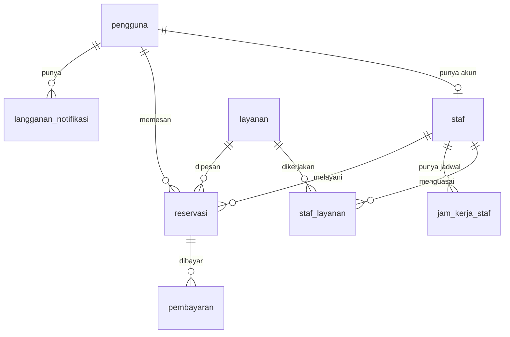

# Dokumentasi Database - Sistem Reservasi Salon

Database untuk aplikasi reservasi salon / klinik kecantikan (Project Akhir Web, Tim 2).

- **Database:** PostgreSQL, dihosting di Supabase
- **Cara terhubung:** lewat `DATABASE_URL` di file `.env` (lihat `.env.example`)
- **Pemegang peran:** Database dan Infrastruktur

---

## 1. Cara membuat ulang database dari nol

File SQL: `00_semua_sekaligus.sql` (sebaiknya disimpan di folder `database/` pada repository).

1. Buka Supabase, pilih project, lalu menu **SQL Editor**.
2. Tempel seluruh isi `00_semua_sekaligus.sql`.
3. Klik **Run** satu kali.
4. Lihat tabel hasil di bagian bawah. Harus ada **12 baris** dan semuanya berstatus **LULUS**.

File itu menjalankan empat langkah berurutan:

| Langkah | Isi | Tugas jobdesk |
|---|---|---|
| 1 | Menghapus tabel lama (jika ada) | - |
| 2 | Membuat 9 tabel, constraint, dan index (migration) | Tugas 2 dan 3 |
| 3 | Mengisi data contoh (seed) | Tugas 4 |
| 4 | Pengecekan otomatis (12 pengecekan) | Bukti tugas 2, 3, 4 |

> **PERINGATAN:** Langkah 1 memakai `DROP TABLE ... CASCADE`, yaitu **menghapus semua tabel beserta seluruh datanya**. Jangan menjalankan file ini pada database yang sudah berisi data dari aplikasi, kecuali memang ingin mengulang dari awal.

---

## 2. Cara mengecek koneksi

Setelah `DATABASE_URL` diisi di `.env`, jalankan query ini lewat aplikasi atau SQL Editor:

```sql
SELECT count(*) FROM layanan;
```

Hasil yang benar: **6** (sesuai data contoh).

Jika koneksi gagal:

- Pastikan tidak ada spasi atau sisa tanda `[ ]` di `DATABASE_URL`.
- Pakai connection string jenis **Session pooler** (host berakhiran `pooler.supabase.com`). Jenis *Direct* hanya mendukung IPv6 dan sering gagal di jaringan IPv4.
- Jika password mengandung simbol (`@`, `#`, `/`, `:`), simbol itu harus di-percent-encode. Cara termudah: pakai password yang hanya terdiri dari huruf dan angka.

---

## 3. Diagram ERD



Gambar ERD lengkap (dengan semua kolom) ada di file `ERD_reservasi_salon.html`.

---

## 4. Daftar tabel

| Tabel | Fungsi | Kolom utama |
|---|---|---|
| `pengguna` | Semua akun (pelanggan, staf, admin) | id, nama, email (unik), password_hash, jenis_kelamin, no_hp, jenis_akun, dibuat_pada |
| `layanan` | Daftar layanan salon | id, nama (unik), deskripsi, harga, durasi_menit, aktif |
| `staf` | Data staf, terhubung ke tepat satu akun pengguna | id, pengguna_id (unik), nama, foto_url |
| `staf_layanan` | Staf mana bisa mengerjakan layanan apa | staf_id, layanan_id |
| `jam_kerja_staf` | Hari dan jam kerja tiap staf | id, staf_id, hari, jam_mulai, jam_selesai |
| `reservasi` | Pesanan pelanggan | id, pelanggan_id, staf_id, layanan_id, tanggal, jam_mulai, jam_selesai, status, total_biaya, dibuat_pada |
| `pembayaran` | Catatan pembayaran (tanpa payment gateway) | id, reservasi_id, jumlah, metode, status, dibayar_pada |
| `galeri` | Alamat foto galeri (file ada di storage) | id, foto_url, keterangan |
| `langganan_notifikasi` | Data langganan Web Push dari browser | id, pengguna_id, endpoint (unik), kunci_langganan (jsonb) |

Nilai yang diizinkan:

| Kolom | Nilai |
|---|---|
| `pengguna.jenis_kelamin` | `laki_laki`, `perempuan` |
| `pengguna.jenis_akun` | `pelanggan` (bawaan), `staf`, `admin` |
| `reservasi.status` | `menunggu` (bawaan), `dikonfirmasi`, `sedang_dikerjakan`, `selesai`, `dibatalkan` |
| `pembayaran.metode` | `tunai`, `transfer` |
| `pembayaran.status` | `belum_bayar` (bawaan), `lunas` |
| `jam_kerja_staf.hari` | angka 0 sampai 6 (0 = Minggu, 1 = Senin, ... 6 = Sabtu) |

---

## 5. Aturan yang dijaga langsung oleh database (constraint)

Aturan ini berlaku walaupun data masuk lewat jalur selain aplikasi.

- Kolom wajib tidak boleh kosong (`NOT NULL`), dan nama tidak boleh hanya spasi.
- Email pengguna tidak boleh kembar.
- Harga layanan tidak boleh negatif, dan durasi layanan harus lebih dari 0.
- Jam selesai harus lebih besar dari jam mulai (reservasi dan jam kerja staf).
- Relasi antartabel dijaga (foreign key): reservasi tidak bisa menunjuk staf, layanan, atau pelanggan yang tidak ada.
- Satu staf hanya punya satu jadwal kerja per hari.
- **Jadwal staf tidak boleh bentrok.** Constraint `reservasi_tanpa_bentrok` menolak dua reservasi untuk staf yang sama pada rentang waktu yang tumpang tindih. Reservasi berstatus `dibatalkan` tidak dihitung, sehingga jam itu bisa dipesan lagi.
- Total biaya dan jumlah pembayaran tidak boleh negatif.

Index yang dibuat (nama diawali `idx_`): `idx_reservasi_pelanggan`, `idx_reservasi_staf_tgl`, `idx_reservasi_status`, `idx_pembayaran_reservasi`, `idx_langganan_pengguna`.

### Catatan keamanan (Supabase)

Semua tabel mengaktifkan **Row Level Security (RLS)** tanpa policy. Artinya Data API Supabase (PostgREST) tidak bisa membaca tabel sama sekali, jadi data tidak bocor lewat kunci publik. Backend Next.js tetap bisa membaca dan menulis karena terhubung langsung lewat `DATABASE_URL` sebagai role `postgres`. Karena itu, **semua akses data harus lewat backend**, bukan langsung dari browser ke Supabase.

---

## 6. Data contoh (seed)

Semua identitas fiktif, hanya untuk demo.

**Password semua akun contoh: `Password123!`**
Password disimpan sebagai hash **bcrypt**, jadi backend harus memakai `bcrypt` atau `bcryptjs` agar login berhasil.

| Email | Peran |
|---|---|
| admin@example.com | admin |
| rina@example.com | staf |
| dewi@example.com | staf |
| maya@example.com | staf |
| sinta@example.com | pelanggan |
| budi@example.com | pelanggan |
| ayu@example.com | pelanggan |
| tono@example.com | pelanggan |

Isi data contoh:

- **6 layanan:** Potong Rambut Wanita, Potong Rambut Pria, Creambath, Facial Brightening, Manicure, Hair Coloring.
- **3 staf** beserta layanan yang dikuasai dan jam kerjanya:
  - Rina: Senin sampai Sabtu, 09:00 sampai 17:00
  - Dewi: Selasa sampai Sabtu, 10:00 sampai 18:00
  - Maya: Senin sampai Jumat, 09:00 sampai 16:00
- **8 reservasi** dengan status bervariasi (selesai, sedang_dikerjakan, dikonfirmasi, menunggu, dibatalkan). Reservasi yang dibatalkan memakai jam yang sama dengan reservasi baru, untuk menunjukkan bahwa jam dari reservasi batal bisa dipesan lagi.
- **4 pembayaran** (3 lunas, 1 belum bayar).
- **4 data galeri** dengan alamat foto contoh. Ganti dengan alamat foto di storage setelah fitur upload dibuat.

---

## 7. Pengecekan otomatis

Bagian terakhir `00_semua_sekaligus.sql` menjalankan 12 pengecekan dan menampilkannya sebagai tabel:

- Ada 9 tabel dari migration.
- Minimal 4 index buatan sendiri.
- Harga negatif, durasi 0, email kembar, kolom wajib kosong, relasi ke staf yang tidak ada, dan jadwal bentrok **semuanya ditolak**.
- Minimal 5 layanan dan 5 reservasi, dengan variasi status, staf, dan tanggal.
- Ada akun untuk 3 jenis akun.

Pengecekan ini tidak mengubah data. Percobaan data salah akan ditolak oleh database, dan hanya dicatat sebagai LULUS.

---

## 8. Hal yang belum dikerjakan

- Upload foto ke storage (tabel `galeri` baru menyimpan alamat).
- Worker, antrean, dan VAPID key untuk Web Push (tabel `langganan_notifikasi` sudah siap).
- Deployment aplikasi dan worker ke server online.
